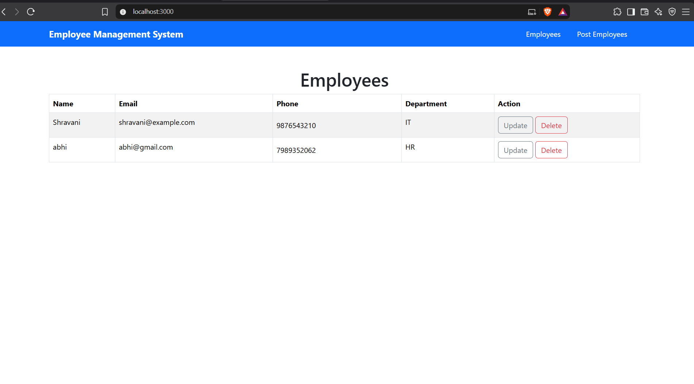
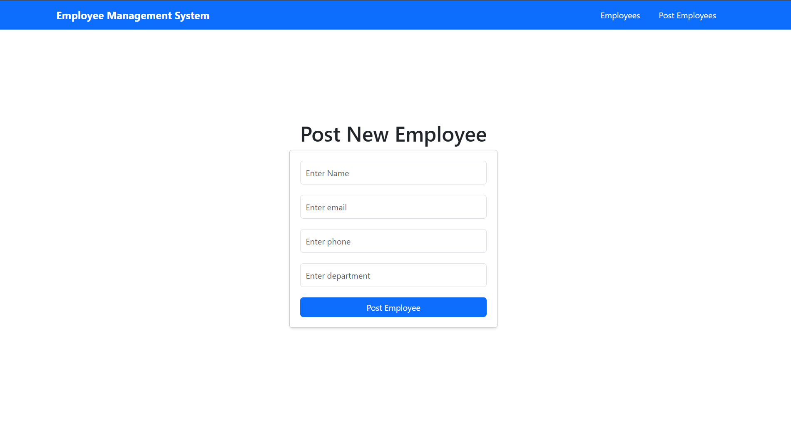
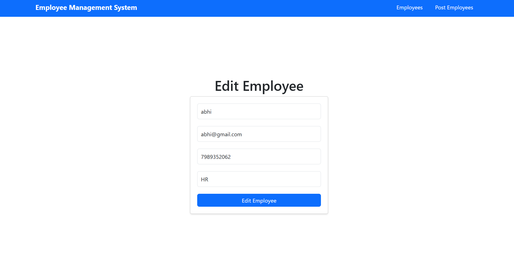

# Employee Management System

A full-stack Employee Management System built using **Java, Spring Boot, React.js, and MySQL**. The application allows users to manage employee records through RESTful APIs and an interactive React frontend.

## Features

- Add new employee records.
- View all employees.
- Retrieve employee details using employee ID.
- Update existing employee information.
- Delete employee records.
- REST API integration between React and Spring Boot.
- MySQL database integration.

## Tech Stack

### Backend
- Java
- Spring Boot
- Spring Data JPA
- Hibernate
- Maven
- REST APIs
- Lombok

### Frontend
- React.js
- JavaScript
- HTML5
- CSS3
- Fetch API

### Database
- MySQL

### Tools
- Git
- GitHub
- Postman
- Visual Studio Code

## Project Structure

```text
employee-management-system/
│
├── backend/
│   ├── .mvn/
│   │   └── wrapper/
│   ├── src/
│   │   ├── main/
│   │   │   ├── java/
│   │   │   │   └── com/crudOperations/employee/
│   │   │   │       ├── controller/
│   │   │   │       ├── entity/
│   │   │   │       ├── repository/
│   │   │   │       ├── service/
│   │   │   │       └── EmployeeApplication.java
│   │   │   └── resources/
│   │   └── test/
│   ├── .gitattributes
│   ├── .gitignore
│   ├── mvnw
│   ├── mvnw.cmd
│   └── pom.xml
│
├── public/
├── src/
├── .gitignore
├── package.json
├── package-lock.json
└── README.md
```

## REST API Endpoints

Base URL: `http://localhost:8080/api`

| Method | Endpoint | Description |
|---|---|---|
| POST | `/employee` | Create employee |
| GET | `/employees` | Retrieve all employees |
| GET | `/employee/{id}` | Retrieve employee by ID |
| PUT | `/employee/{id}` | Update employee |
| DELETE | `/employee/{id}` | Delete employee |

### Sample Employee JSON

json
{
  "name": "abhishek",
  "email": "abhi@example.com",
  "phoneNumber": "9876543210",
  "department": "IT"
}


## Installation and Setup

### Prerequisites

- Java JDK
- Node.js and npm
- MySQL

### 1. Clone the repository

```bash
git clone https://github.com/MounikaReddy290/employee-management-system.git

cd employee-management-system
```

### 2. Configure MySQL

Create a MySQL database and configure your database connection in:

`backend/src/main/resources/application.properties`

Keep your database credentials private. Do not commit passwords or API secrets to GitHub.

### 3. Start the Spring Boot Backend

Open a terminal:

```bash
cd backend

# Windows
mvnw.cmd spring-boot:run

# macOS/Linux
./mvnw spring-boot:run
```

The backend runs at:

`http://localhost:8080`

### 4. Start the React Frontend

Open another terminal in the project root:

```bash
npm install

npm start
```

The React development server typically runs at:

`http://localhost:3000`

## API Testing

The REST APIs can be tested using Postman.

Test the following operations:

- Create an employee.
- Retrieve all employees.
- Retrieve an employee by ID.
- Update employee details.
- Delete an employee.

## Screenshots

### Employee List


### Add Employee


### Update Employee


## Future Improvements

- Implement pagination and sorting.
- Add employee search functionality.
- Introduce authentication and authorization.
- Improve automated test coverage.
- Deploy the frontend and backend.

## Author

**Mounika Gaddam**
Base URL: `http://localhost:8080/api`

git clone https://github.com/MounikaReddy290/employee-management-system.git

- **GitHub:** [MounikaReddy290](https://github.com/MounikaReddy290)
- **LinkedIn:** [Mounika Gaddam](https://www.linkedin.com/in/mounika-reddy29/)
- **LeetCode:** [Mounika299](https://leetcode.com/u/Mounika299/)
